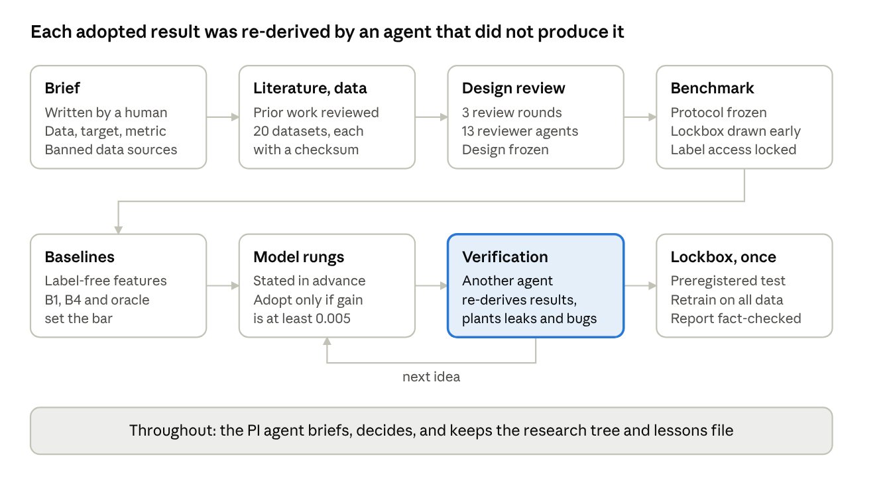
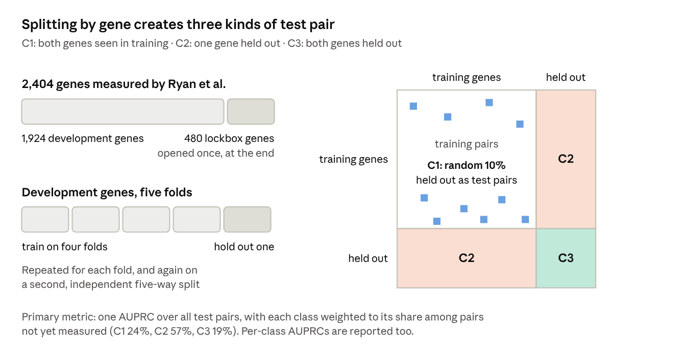
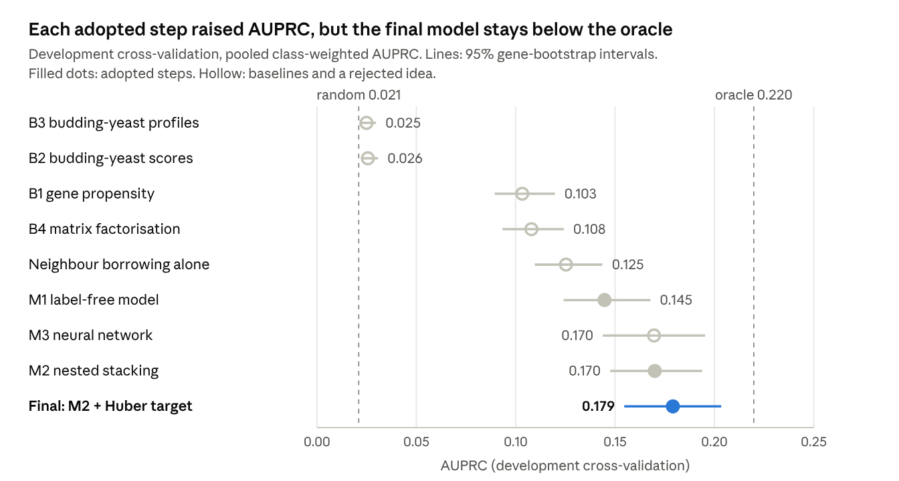
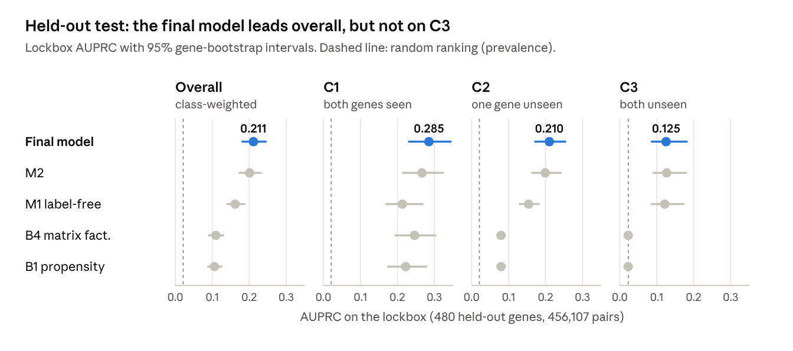
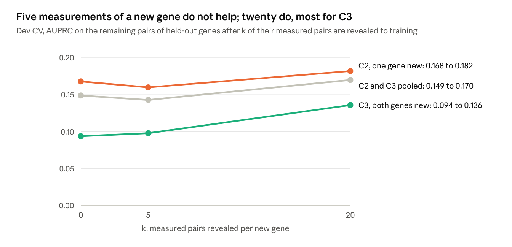

# Predicting synthetic lethality in fission yeast with an agent-run research team

29 October 2026 · written by an AI agent (Claude Opus 5.5); see the disclaimer in the repository README

An AI "principal investigator" and a team of AI agents built and tested a model that ranks all 7.7 million pairs of non-essential fission yeast genes by their chance of being synthetic lethal. On a held-out test built around 480 genes that no model had seen, it reaches an AUPRC of 0.21, against 0.02 for random ranking and 0.11 for the best simple baseline.

## Summary

**Question.** Two genes are synthetic lethal (or, more broadly, have a strong negative genetic interaction) when losing both together harms the cell much more than losing either alone. Only a fraction of gene pairs has ever been tested. Can we rank all untested pairs in fission yeast, *Schizosaccharomyces pombe*, by how likely they are to interact this way, including pairs of genes that were never tested at all?

**Approach.** The project was run by an AI system acting as principal investigator (PI). It delegated literature review, data collection, design critique, coding, modelling and independent verification to other AI agents, and kept a written research record. It was told to train only on one published fission-yeast interaction map (Ryan et al. 2012) and to avoid any data that could leak interaction information back into the inputs. The final model combines public gene-level data, the budding-yeast interaction map (Costanzo et al. 2016) and features learned from the training map. It was evaluated once on a held-out set of genes that were set aside before modelling began.

**Results.**

- On the held-out test, the final model reached an area under the precision-recall curve (AUPRC) of **0.211**, 95% CI 0.179 to 0.247.
- Random ranking gives 0.021, and the best simple baseline gives 0.110. In development testing the same model scored 0.179, so a realistic expectation for new genes is about 0.18 to 0.21.
- For pairs where *both* genes were absent from training, the AUPRC was 0.125 (95% CI 0.084 to 0.184; 0.094 in development testing), about five times random.
- The model scores all 7,693,003 pairs of non-essential genes in about 24 minutes on a laptop.

**Main caveat.** Most of what the model knows is which genes interact *a lot*, not which specific partners they interact with. A model that knew only each gene's true interaction rate would score higher than ours (0.22 against 0.18 in development testing). Our main lever, and our main limit, is predicting that rate for genes that were never measured.

## Background

**Why gene pairs matter.** Many genes can be deleted from a yeast cell with little visible effect, because other genes back them up. When two genes back each other up, deleting both can kill the cell or slow its growth sharply. This is called synthetic lethality, or more generally a negative genetic interaction. Maps of these interactions reveal which genes work in the same pathway or complex. They also underpin a cancer-therapy strategy: drugging the partner of a gene that a tumour has already lost.

**How interactions are measured.** In an epistatic miniarray profile (E-MAP), a set of "query" mutants is crossed against a library of "array" mutants, and the growth of each double mutant is compared with what is expected from the single mutants. Ryan et al. (2012) did this in fission yeast. They screened 953 query alleles against a library of about 2,000 deletion strains, giving roughly 1.3 million scored gene pairs. Each pair has an S-score: strongly negative scores mean the double mutant grows worse than expected. Following the paper, we call a pair a hit when its S-score is below −2.3. Under that definition, 1.9% of measured pairs are hits.

**Why prediction is hard.** Fission yeast has about 3,800 non-essential protein-coding genes, which gives about 7 million pairs. Ryan et al. measured about one in seven of them. More importantly, 39% of the non-essential genes were never measured at all, so 63% of all pairs involve at least one never-measured gene. A useful predictor must therefore work for genes it has no interaction data for. Published synthetic-lethality predictors often do not: a 2024 benchmark of 12 machine-learning methods found that performance collapses towards chance when both genes are new (Feng et al. 2024).

**The brief.** The project brief fixed the training data (Ryan 2012 only), the target (S-score below −2.3), the metric (AUPRC) and the requirement to handle unseen genes. It allowed the full budding-yeast map of Costanzo et al. (2016) and other datasets, but banned three kinds of input that could smuggle interaction knowledge into the features: fission-yeast interaction data from any other source, anything derived from text mining (such as the STRING network), and the Gene Ontology. Gene Ontology annotations are partly inferred from interaction experiments.

## Key terms

| Term | Meaning in this briefing |
| --- | --- |
| Hit (positive pair) | A gene pair with Ryan S-score below −2.3: a strong negative interaction. |
| Prevalence | The share of pairs that are hits, about 2%. Random ranking scores an AUPRC equal to the prevalence. |
| Precision, recall | Go down a ranked list and stop somewhere. Precision is the share of pairs above that point that are true hits. Recall is the share of all true hits found so far. |
| AUPRC | Area under the precision-recall curve: precision averaged over every recall level as you go down the list. 1 is perfect; random equals the prevalence. It suits rare positives better than AUROC. |
| AUROC | Area under the ROC curve: the chance that a random hit is ranked above a random non-hit. Random is 0.5 whatever the prevalence, which makes it flattering when hits are rare. |
| Seen / unseen gene | A gene with or without interaction measurements in the training data. |
| C1, C2, C3 | Test pairs where both genes are seen (C1), exactly one is unseen (C2), or both are unseen (C3), following Park and Marcotte (2012). |
| Gene-disjoint split | Splitting by gene rather than by pair, so test genes have no pairs at all in training. |
| Lockbox | 480 genes set aside before modelling and used exactly once, for the final test. Also called the held-out test set. |
| Dev CV | Development cross-validation: the remaining genes split five ways, used to choose between models. |
| Label-free feature | An input that does not use the training labels, for example a gene's phenotype profile or its budding-yeast ortholog's interactions. |
| Gene propensity | How interaction-prone a gene is: its share of hits among its measured pairs. |
| Stacking, cross-fitting | Stacking: a second model combines scores computed by other methods with the original features. Cross-fitting: each training row's scores are computed only from data that exclude that row, so the second model never sees a score that already knows the answer. |
| Leakage | Any route by which information about test labels reaches the model during training, which inflates scores. |
| Agent | An AI model instance given a task, tools and files. It works on its own and reports back in text. |

## How the project was run

A human scientist wrote one brief and did not intervene afterwards. Everything else was done by AI agents, coordinated by one agent acting as PI. The whole project took about 10.5 hours of wall-clock time on one laptop (Apple M4, 10 cores, 32 GB memory). It produced 84 git commits and 83 registered model runs.

**Division of labour.** The PI agent did not write most of the code. It wrote task briefs, read the agents' reports, decided what to do next and kept three running documents:

- a *research tree*: every idea tried, its status and a dated decision log;
- a *lessons* file of process rules learned from mistakes;
- the final report.

Other agents did the literature review, data collection, design critique, feature building, modelling, deliverable engineering and verification. Several worked in parallel, each in its own copy of the code repository and with its own list of files it was allowed to change.

**Design by critique.** Before any modelling, the PI drafted a design document. It went through three rounds of review by 13 independent reviewer agents, each given one role: external PI, statistics, data, algorithms and compute, prior work, fission-yeast genetics, and AI-agent failure modes. The reviews changed the design substantially. The most important changes were:

- weighting the metric towards the kinds of pairs the tool will actually face (next section);
- building features from the training labels only through nested cross-fitting (Step 4).

The third round, the last the brief allowed, produced only wording fixes.

**Guard rails.** The brief demanded reproducibility and warned against making results look better. The PI turned this into mechanical rules:

- The evaluation protocol (labels, threshold, splits, metric, seeds) was written to one configuration file and frozen by checksum.
- The held-out lockbox genes were drawn early and never touched until the end.
- Code could reach labels only through functions that return training-fold labels. Automated tests ("lints") failed the build if any other file read the label files.
- Every run recorded its git commit and whether the code had uncommitted changes ("dirty"). Only clean runs could be adopted.
- A model change was adopted only if it passed a fixed statistical rule, stated before the run (Step 1).
- Every adopted result was re-checked by an agent that had not produced it. That agent wrote its own code and planted deliberate bugs to make sure its checks could catch them.

*Source: project workflow, 8 phases*

Figure 1. The flow of the project. The loop between model rungs and verification ran once for each adopted model.

## Step 1: building a fair benchmark

The most consequential decisions came before any model was trained: what counts as a hit, which pairs the tool must cover, and how to test it so that the score reflects real use. A careless split would have made almost any model look good.

**Labels.** Ryan et al. published two versions of the scores. Their Dataset S2 gives one averaged score per gene pair, and the project used it as the label source, with a hit defined as S2 below −2.3. Averaging shrinks pairs measured in only one direction, so this definition is stricter than applying −2.3 to raw scores: 1.9% of pairs are hits, against 4.3% on the raw scale. The raw-scale labels were used only as a sensitivity check.

**The universe of pairs to predict.** "Non-essential" was taken from PomBase gene viability records. The universe is the 3,779 protein-coding genes that are viable or conditionally viable, or that have a Ryan deletion strain. Another 144 genes of unknown viability are scored but flagged. That gives 3,923 genes and 7,693,003 pairs. Viability was used only to define this list, never as a model input. Pairs measured only with weakened alleles of essential genes (so-called DAmP alleles) are not deletion pairs, so they were excluded from evaluation.

**Three kinds of test pair.** Park and Marcotte (2012) showed that pair-prediction methods behave very differently depending on whether the test pair's genes were seen in training. In a random split of pairs, almost every test pair has both genes seen (class C1), so a model can score well just by memorising which genes interact a lot. The project therefore split by *gene*: held-out genes have no pairs at all in training. This creates C2 pairs (one gene held out) and C3 pairs (both held out). A random 10% of seen×seen pairs were also held out to measure C1.

**The lockbox.** Early in the project, before any modelling, 480 of the 2,404 measured genes were drawn at random and set aside. The draw was stratified by screen role (query or array), by interaction rate, and with a separate group for heavy interactors, so the lockbox resembles the rest. A further 10% of pairs among the remaining genes became the lockbox's C1 set. The lockbox was opened once, at the end. One disclosure: during the first design-review round, before the lockbox was drawn, two reviewer agents ran exploratory checks on all of the data. No modelling choice was based on them.

**Development testing.** The remaining 1,924 genes were split into five gene folds for cross-validation (dev CV). Every candidate model was trained five times, each time predicting one fold's held-out genes. A second, independent five-way split (seed 7) was used to check that improvements were not an accident of one particular split.

**The metric.** AUPRC rewards putting true hits at the top of a ranked list. Random ranking scores the prevalence, about 0.02. C1, C2 and C3 pairs occur in different proportions in any test set, and in different proportions again among the pairs that users will actually query: those not yet measured. The primary metric is therefore one AUPRC over all test pairs pooled, with each class weighted to its share among the unmeasured universe pairs (C1 24%, C2 57%, C3 19%). In practice every test pair carries a weight, chosen so that each class contributes in those proportions. Per-class AUPRCs are reported too.

**Deciding what counts as an improvement.** Pairs that share a gene are not independent, so uncertainty was estimated by resampling *genes* (a gene bootstrap, 1,000 replicates), comparing two models on the same resamples. A change was adopted only if all three held:

- the 95% confidence interval of the improvement excluded zero;
- the improvement was at least 0.005 AUPRC;
- the improvement also held on the second split.

**A noise reference.** Some pairs were measured twice, with each gene in turn as the query. One measurement predicts the other's label with an AUPRC of only 0.35. This is not a hard ceiling for a model, but it shows how noisy the labels are.

*Source: benchmark design: gene split and test-pair classes*

Figure 2. Left: how genes were divided. Right: a gene-by-gene matrix for one development fold, showing where each class of test pair comes from (not to scale).

## Step 2: inputs, and keeping them clean

For genes with no interaction data, a model can only reason from other information about them. The project gathered 20 public datasets. Each was registered with its source, version, checksum and licence, and each was classed as a model input, a label source, or a universe-only reference.

**What went in.** The label-free inputs fell into eight groups of data, plus a flag for weakened alleles, totalling 358 features per pair:

- **Phenomics:** growth of each deletion mutant across about 130 conditions (Rodríguez-López et al. 2023), plus the fitness of heterozygous deletion strains from the deletion-library study (Kim et al. 2010).
- **Budding-yeast orthologs:** each gene's counterpart in *S. cerevisiae*, matched with PomBase's curated ortholog list, and that counterpart's interactions, fitness and interaction profile in the Costanzo et al. (2016) map.
- **Protein interactions:** physical interactions from BioGRID.
- **Expression:** RNA and protein abundance, and co-expression.
- **Knockout proteomes:** how each deletion changes the rest of the proteome (Öztürk et al. 2022).
- **Protein localisation:** from a genome-wide fluorescent-tagging screen (Matsuyama et al. 2006).
- **Sequence:** protein domains, and embeddings from the ESM-2 protein language model (Lin et al. 2023).
- **Conservation:** presence of orthologs across species.

Features were computed for both single genes (for example, "how many conditions does this deletion affect?") and pairs (for example, "how similar are the two genes' phenotype profiles?").

**What was kept out, and why.** The brief banned inputs that could carry interaction knowledge. Applying that rule meant going through each source in detail:

- PomBase phenotype annotations were excluded because they include double-mutant phenotypes, which are interaction data.
- A fission-yeast fitness table (Koch et al. 2012) was excluded because it was derived from interaction-screen control plates.
- Ryan et al.'s own published gene-similarity table was excluded because it was computed from all of their data, including pairs that would later be test pairs.
- In BioGRID, only physical interactions were used. Even then, 40% of fission-yeast rows came from publications that also reported genetic interactions. Those were removed with a blocklist of publication IDs, because such experiments may have been chosen *because* of known genetic interactions.
- Gene Ontology, STRING and any resource built from them were excluded.

The allowed sources were listed in a machine-readable file, and automated tests failed if any feature file named a source outside it.

**A licensing point.** The Ryan 2012 data come under a publisher licence that does not allow redistribution. No raw data or pair-level predictions derived from them were committed to the repository; only summary statistics were.

## Step 3: simple baselines and an oracle show where the signal lies

Before building anything complex, the project measured how far simple ideas get. This step shaped everything after it.

**Gene propensity alone (baseline B1).** Each gene gets one number: how interaction-prone it is, fitted from its training pairs. A pair's score is the sum of its two genes' numbers. This reached a dev-CV AUPRC of 0.103, five times random. But it says nothing about unseen genes. C2 pairs are ranked only by their seen gene, and every C3 pair gets the same score, so C3 is at chance.

**Matrix factorisation (B4).** This is the classic approach for filling gaps in an interaction matrix, also used in synthetic-lethality prediction (Liu et al. 2020). It gave 0.108, barely better than B1, and like B1 it cannot score unseen genes.

**Budding-yeast interactions alone (B2, B3).** Two scores were transferred from orthologs: the Costanzo interaction score of the orthologous pair, and the similarity of the two orthologs' interaction profiles. Both scored about 0.025, barely above random. This matches Ryan et al. (2012), who found that individual negative interactions are poorly conserved between the two yeasts (about a quarter overall, after correcting for noise), while whole modules are much better conserved.

**An oracle.** As a thought experiment, the true interaction rate of each held-out gene was computed from the held-out data itself and plugged into the B1 formula. This is cheating, so it is not a model, but it shows what perfect knowledge of gene propensity would be worth. It reached **0.220**, with C3 at 0.235. That is higher than any model the project later built.

**Borrowing from similar genes (NBR).** This was a first attempt to reach unseen genes. For a pair (a, b), the method finds the 20 training genes most similar to b under a label-free similarity, for example correlated phenotype profiles, and asks how often those neighbours were hits with a. It also asks how often a's neighbours were hits with b's neighbours, which works even when neither gene was measured. Only training pairs are counted. Averaged over nine similarity sources, this scored 0.125 and lifted C2 from 0.080 (B1) to 0.117. C3 stayed close to chance.

**What this taught.** Most of the predictable signal is gene-level. Knowing which genes are heavy interactors is worth more than any pair-specific information tried here. The central problem became: *predict how interaction-prone a gene is, from data that do not involve its interactions.*

## Step 4: the model that worked

The final model was reached in three adopted steps. Each step passed the adoption rule from Step 1 and was then re-checked by an independent agent.

**4a. A model of label-free features (M1).** The project trained gradient-boosted decision trees with LightGBM (Ke et al. 2017) on the 358 label-free features. This kind of model builds hundreds of small decision trees, each correcting the errors of the ones before. It scored **0.145** in dev CV (C1 0.214, C2 0.134, C3 0.088), beating gene propensity (B1) by 0.041 \[0.031, 0.051\].

It was also the first model to do clearly better than chance on C3. To check that this came from real gene information, the features were shuffled between genes. The score then fell to 0.071, and C3 fell to chance.

Removing one feature group at a time showed where the signal was. Only phenomics clearly mattered on its own (worth +0.022). Budding-yeast orthologs added a marginal +0.004 (CI 0.000 to 0.009). The most useful features described how "sick" a gene's deletion is: how many conditions it affects, how fit the budding-yeast ortholog's deletion is, and how often that ortholog has negative interactions. Expression, protein interactions, localisation, proteomes, sequence embeddings and conservation added little once these were present.

**4b. Adding what the training data say, without cheating (M2).** Some information is available only from the training labels: each seen gene's measured interaction rate, matrix-factorisation scores, and the neighbour-borrowing scores from Step 3. The project also added an explicit *gene-propensity model*: a regression that learns, on training genes, to predict a gene's interaction rate from its label-free features, and is then applied to unseen genes.

Using label-derived features naively causes a subtle failure. If a gene's interaction rate is computed from the same pairs the model then trains on, every training row "knows" its own answer. The model learns to trust these features, and then they disappoint on test pairs. The fix is nested cross-fitting, a form of stacking (Wolpert 1992). Each training row's label-derived features are computed only from data that exclude that row, so the second-stage model learns from features that are as noisy as they will be at test time:

1. Inside each training set, the genes are split again into five inner folds. The split is by gene, so each inner fold's genes play the part of unseen genes.
2. Label-derived features for each inner fold's pairs are computed only from the other inner folds. This produces honest training rows that look like C1, C2 and C3 test pairs.
3. A second-stage LightGBM learns from these honest rows how far to trust each feature for each kind of pair. It sees the 358 label-free features as well as the label-derived ones.
4. For the real test pairs, the same features are computed from the full training set.

This model (M2) scored **0.170** (C1 0.251, C2 0.159, C3 0.095), +0.025 \[0.019, 0.033\] over M1, and +0.031 on the second split.

Removing one family at a time:

- neighbour borrowing was the most valuable (+0.019);
- the gene-propensity model added only +0.003, which is not significant.

The gene-propensity model also failed a check stated in advance: on simulated data with a known answer, its predictions for unseen genes correlated 0.56 with the truth, against a target of 0.6. It was kept because it belongs to a block of label-derived features that passed as a whole, but its own value is unproven.

**4c. Learning from the score, not the yes/no label (M2r\_huber).** The last gain came from changing what the second stage learns, not what it sees. A yes/no label treats a pair at −2.2 the same as a pair at 0, and a pair at −2.4 the same as one at −12. The second stage was instead trained to predict the size of the negative score, −min(S2, 0), using a Huber loss (Huber 1964). This loss behaves like squared error for small errors and like absolute error for large ones, so a few extreme scores cannot dominate. The switch point was set at 2.3, the hit threshold. The yes/no label still decided when to stop training, and evaluation was unchanged.

This scored **0.179** (C1 0.272, C2 0.167, C3 0.094): +0.009 \[0.005, 0.013\] over M2, and +0.006 on the second split. Nearly all the gain was in C1 and C2.

The final model averages three runs with different random seeds. It uses 475 features: 358 label-free, 9 from the training labels, 100 from neighbour borrowing and 8 from the gene-propensity model.

*Source: results/registry.tsv, clean dev-CV runs, primary split*

Figure 3. The model ladder. The intervals for individual models overlap because genes vary a lot. Each adopted step was judged on its *paired* difference from the previous model, computed on the same gene resamples, and that difference excluded zero every time. The oracle uses the true held-out interaction rates, so it is a reference, not a model.

**Credit to the literature.** Almost every ingredient came from earlier work. Most of it was collected by the literature-review agent before the design was drafted. Nested stacking was proposed by design reviewers in round 2, and the general machine-learning methods (stacking, LightGBM, the Huber loss) are standard tools:

- **Splitting pairs into C1/C2/C3**, and reporting each separately: Park and Marcotte (2012).
- **Expecting graph-only methods to fail on unseen genes**, and preferring feature-based tree models: the benchmark of Feng et al. (2024), and the bias analysis of Seale et al. (2022), which also found gene fitness to be the strongest single feature.
- **Decomposing a pair's chance into the two genes' propensities**, with sickness, complex membership and conservation as drivers: Koch et al. (2012), who also showed that interaction degree can be predicted across species, and the budding-yeast map of Costanzo et al. (2016).
- **Using budding-yeast data at the level of profiles and modules, not single edges**: the cross-species analysis in Ryan et al. (2012).
- **Neighbour borrowing**: nearest-neighbour imputation of E-MAP matrices (Ulitsky et al. 2009; Ryan et al. 2011). The project's variant uses only label-free similarity to choose neighbours, so that it reaches unseen genes, and cross-fits it.
- **Closest prior work on this exact matrix**: Fan et al. (2020) imputed the Ryan map by matrix factorisation that also draws on budding-yeast data and side information such as protein-network similarity, evaluated on random pairs. It is the nearest precedent for our matrix-factorisation baseline, neighbour borrowing and cross-species ideas.
- **Degree-only and shuffled-feature controls**: Eid et al. (2021).
- **Phenomics data, the strongest single input**: Rodríguez-López et al. (2023).

The continuous Huber target was not taken from the synthetic-lethality literature. It was a design-stage idea listed for testing, and it is a standard robust-regression device.

## Step 5: what did not work

Seven further ideas were tested against the same rule, and none passed. All but the last, which was an ablation inside M2, were stated in advance: their comparison and pass criteria were written to a configuration file before the run.

| Idea | Rationale | Result (change in dev AUPRC) |
| --- | --- | --- |
| Cross-species propensity transfer | Learn in budding yeast to predict a gene's interaction rate from its sequence and protein-interaction features (using Costanzo labels), then apply the learned model to fission-yeast genes | +0.0002, not significant. It predicted held-out budding-yeast genes with rank correlation 0.39, but only 0.25 after transfer, and added nothing to the ortholog features already in the model |
| Averaging five random seeds | Cheap variance reduction; it had helped M1 | +0.003 on M2 and +0.002 on the final model: real but below the 0.005 bar |
| A simple model just for C3 pairs | A low-capacity logistic model on gene-level features, blended into the ranking for C3 pairs only | −0.0001 |
| Continuous label-derived features | Compute gene propensities and neighbour scores from the continuous score too, not only from hits | −0.0001 to −0.0007. Passed its simulated-data check, but on the real data the continuous and yes/no propensities were already 91% rank-correlated |
| Neural network (one attempt) | A two-tower network that encodes each gene and combines them symmetrically, trained on the same rows | −0.010 on its own |
| Rank-average ensembles | Average the rankings of the final model with matrix factorisation, neighbour scores, M1 or the neural network | −0.034 to +0.0015; none significant |
| Gene-propensity baseline as a starting point | Start the boosted trees from the gene-propensity baseline's predictions | −0.0002 |

**What the failures teach.**

- **Pairs where both genes are unseen barely moved after M1.** C3 stayed between 0.088 and 0.099 across every idea aimed at it. The gap to the oracle (0.235) appears to be a gap in what the label-free data say about a gene's propensity, rather than in the modelling machinery. The evidence is indirect: the failure of the ideas above, including a single neural-network attempt, not a direct test.
- **Averaging only helps when the members are nearly as good.** Rank ensembles with much weaker members diluted the final model.
- **Bundled gains can hide failed parts.** One run combined seed averaging with the Huber target and reported +0.011. Tested one step at a time, the seed averaging contributed only +0.002 and was dropped.

The project's stop rule was three consecutive failed rounds with no well-supported idea left. The PI stopped after two failed rounds, judging that each remaining idea had an expected gain below the adoption bar. That is a judgement call, and it is recorded as such.

## Step 6: the one-shot held-out test

On the 480 lockbox genes, the final model scored **0.211** (95% CI 0.179 to 0.247). It ranked first of the five preregistered models, and it beat each of the other four by a statistically significant margin.

**How the test was run.** Before opening the lockbox, the PI committed a preregistration file. It fixed:

- the headline model, which would be shipped whatever the ranking showed;
- the four comparison models: M2, M1, and the two baselines B1 and B4;
- the random seeds and the rule for the number of training rounds;
- the four comparisons to test, with Holm's correction for testing several at once.

A script retrained every model on all the development data (for the learned models, 775,918 training pairs from 1,904 protein-coding genes) and scored the 456,107 eligible lockbox pairs once. It logged every access and refuses a second run unless explicitly overridden. The first attempt was refused by the script itself, because of a path bug in its own safety check, before any lockbox data were read. The bug was fixed, a regression test was added, and the second attempt completed. The log shows exactly one completed run.

*Source: results/lockbox/lockbox_result_deec74e31a7c.json, one-shot run*

Figure 4. Held-out test results by pair class. The baselines B1 and B4 cannot score unseen genes, so they sit at random on C3. All three learned models are about equal on C3 (0.12 to 0.13), so the label-derived features and the Huber target help C1 and C2 only.

**Comparisons** (final model minus each other model, 95% CI; all four remain significant after correction):

- vs B1 +0.105 \[0.079, 0.135\]
- vs B4 +0.101 \[0.075, 0.131\]
- vs M1 +0.049 \[0.033, 0.067\]
- vs M2 +0.010 \[0.003, 0.017\]

Other views of the same predictions:

- AUROC is 0.86.
- Among the 1,000 top-ranked lockbox pairs, class-weighted precision is 0.55: roughly half are true hits, against 2% at random.

**Higher than development testing: real, or a leak?** Every learned model scored better on the lockbox than in dev CV: the final model 0.211 against 0.179, M1 0.162 against 0.145. The baselines did not (B1 0.106 against 0.103). The results had also exceeded the expectations the literature agent wrote down before the design: for C2 it had suggested 0.04 to 0.09, and it had flagged any C1 score above about 0.25 as a reason to audit for leakage. Those expectations were extrapolated from studies with balanced or random-pair evaluations, so they were rough, but exceeding them was still a reason to check. So an independent agent audited the lockbox evaluation. It:

- re-derived every number with its own code;
- confirmed that no lockbox gene or pair was in any training set;
- confirmed that the lockbox genes match the development genes in hit rate, degree and data coverage.

Its conclusion was that the gap is not statistically significant (about 1.5 standard errors) and is driven by a handful of genes: dropping just five lockbox genes moves C2 from 0.210 to 0.183. Training on all development genes rather than 80% of them explains a small part of it. The baselines do not move because they ignore the unseen gene by construction.

The honest summary is that the final model's AUPRC on new genes is probably about **0.18 to 0.21**.

**The deliverable.** The final model was then retrained on all of Ryan's data (1.31 million pairs, 2,376 genes) and used to score all 7,693,003 universe pairs. This took 24 minutes on 4 CPU threads, with an 18 GB memory peak. The output gives each pair:

- a score and a rank;
- its class relative to Ryan's data;
- a flag for genes of unknown viability;
- a flag for gene pairs closer than 300 kb on a chromosome;
- for pairs Ryan measured, a score from a model that did not see that pair.

That last score matters. On measured pairs, the in-sample score has an AUPRC of 0.34 against 0.21 for the held-out score. Users should not mistake the first for predictive accuracy. Note also that 658 of the top 1,000 pairs were already measured by Ryan; users looking for new candidates should filter to unmeasured pairs.

## Step 7: rarely seen genes, a few new measurements, and gene linkage

The brief asked for predictions for genes that are "not seen or rarely seen". Three report-only analyses probed how the model behaves at these edges. They were not used to choose a model.

**No gene in Ryan's data is rarely measured.** In every development fold, each measured gene has at least 106 training pairs, because the screen crosses whole sets of strains against each other. In this data, "rarely seen" really means genes with few *hits*. For C2 pairs, accuracy was grouped by how many training hits the seen gene has:

| Training hits of the seen gene | 0 | 1–2 | 3–9 | 10 or more |
| --- | --- | --- | --- | --- |
| AUPRC | 0.008 | 0.022 | 0.055 | 0.194 |
| Share of pairs that are hits | 0.25% | 0.42% | 0.93% | 4.3% |

Absolute accuracy follows the gene's base rate. Relative to that rate, the model ranks pairs 3 to 6 times better than chance in every group, so it remains useful for quiet genes. It simply has fewer hits to find there.

**A few new measurements do not help yet.** To mimic a user who measures a handful of pairs for a new gene, k measured pairs of each held-out gene were revealed to training (k = 5 or 20), and the remaining pairs were scored. This simulates the few-shot case.

Revealing 20 pairs per gene raised pooled C2 and C3 AUPRC by 0.021 (95% CI 0.010 to 0.031), and C3 alone by 0.043. Revealing 5 pairs made no significant difference: −0.006, with a CI of −0.015 to +0.003.

*Source: results/rarely_seen/fewshot.json, 5 folds × 3 seeds*

Figure 5. Accuracy for new genes after revealing k of their measurements. The same pairs are scored at every k.

The k = 5 result is a weakness, though each fold used a single random draw of revealed pairs, so it is not a firm negative. A plausible but untested explanation is that the second-stage model never saw training rows for sparsely measured genes. So it trusts a noisy rate from five pairs as if it came from hundreds, instead of falling back on the gene-propensity prediction. This does not affect predictions made from Ryan's data, where every measured gene has over 100 pairs. It would matter for anyone adding new data, and it is the first follow-up listed below.

**Physically close genes.** Making a double mutant of two genes that sit next to each other on a chromosome is hard, because they rarely separate during crosses. Ryan et al. removed such pairs. Indeed, the screen covers 6% or less of pairs closer than 300 kb, against about 77% elsewhere. The tool cannot be checked there, so it flags these 353,615 pairs rather than adjusting their scores.

Pairs 300 to 1,500 kb apart on the same chromosome show a small but clear excess of hits: 2.1 to 2.2%, against 1.8% for genes on different chromosomes. Development-stage model scores did not track this excess. It may be a mild artefact of linkage in the scoring, and it is reported, not modelled.

## The project as an exercise in agentic science

The agents produced a working, tested tool in about ten hours. They also made a steady stream of errors. What made the result trustworthy was not that agents avoided mistakes, but that the process caught them, mostly through agents checking other agents' work.

**Checks that earned their keep.**

- **Independent re-derivation.** Five times, an agent that had not produced a result rebuilt it with its own code: the infrastructure, M2, the Huber model, the lockbox evaluation and the final report. Every model number was reproduced exactly.
- **Planted bugs.** The first verifier deliberately broke the code in 11 ways. The original tests missed 4 of them, so the tests were strengthened until all 11 were caught.
- **Leak canaries.** Verifiers scrambled every label a model should not see and checked that its features did not change, apart from one feature that jitters slightly with the number of CPU threads. They also planted a real leak to prove the check could fire.
- **Negative controls.** With labels shuffled inside the training data, M2 and the final model fell to the random level (0.023 and 0.022, against 0.021). Shuffling M1's features between genes halved its score and put C3 at random.
- **One step at a time.** Requiring each change to pass on its own exposed a bundled gain (Step 5).
- **A fact-check of the final report** by a fresh agent found 12 errors, listed below.

**Errors the process caught.**

- **Unrepeatable runs.** All the first baseline and M1 runs were made with uncommitted code changes, so none could be adopted. All were rerun.
- **A lockbox exposure.** A per-gene summary of hit counts that included lockbox genes was briefly committed to the repository, then removed. Two design reviewers had also probed all of the data before the lockbox was drawn. Neither event fed a modelling decision, but both are real exposures.
- **A silent input change.** Merging the cross-species features into the shared feature store silently changed the default inputs of older model scripts. Inputs are now pinned in configuration.
- **A safety-check bug.** The lockbox script refused its first real run because of a bug in its own path check. It had only been tested in a simpler folder layout.
- **A false reproducibility claim.** An early verifier estimated that one feature varied by about one part in a million between runs, and the PI recorded runs as effectively reproducible. A verifier showed that changing the number of CPU threads moves single results by about ±0.001, so that claim was wrong.
- **Errors in the report draft.** The fact-check found:
  - stale numbers from an earlier run, for example 17% instead of 5% for the share of C3 pairs in the top 100,000;
  - three missing disclosures: the lockbox exposure, the failed gene-propensity check and the data licence;
  - an overclaim about how much of the gap for unseen genes had been closed.

**Costs and blind spots.**

- **Time on design.** About a third of the first three hours went on the design phase, and the third review round changed nothing of substance.
- **Low-value pipelines.** Agents built some feature pipelines before a cheap test showed whether they could help. The cross-species pipeline cost a feature builder, a merge tool and a configuration bug for +0.0002.
- **Confident reports.** Agents report in the same confident tone whether they are right or wrong. Re-derivation was the only reliable remedy.
- **No expert in the loop.** No human biologist reviewed the scientific choices: the choice of S2 over raw scores, the definition of "non-essential", the exclusion list. Agents made them, documented why, and had them critiqued by other agents playing domain roles. That is not the same as review by a fission-yeast geneticist.

The PI kept a lessons file of process rules, updated at each milestone, partly from retrospectives by fresh agents asked "what should we stop doing?" and "what worked well?". Its main rules are reflected in the take-aways below.

## Limitations

1. **The model mostly predicts which genes interact, not with whom.** Gene propensity carries most of the signal, and the oracle shows that perfect knowledge of it alone would beat our model. Pair-specific signal (which partner of a heavy interactor is the hit) is weak. A high score for a pair is largely a statement about its two genes.
2. **Unseen genes are only partly solved.** For pairs where both genes are new, AUPRC is about 0.09 to 0.13: well above random (0.02), but far below the 0.24 an oracle reaches. Four targeted ideas failed to move it. The bottleneck appears to be the label-free gene data themselves.
3. **Scores are not calibrated probabilities, and classes do not mix well.** Pairs with both genes unseen get compressed scores. Among the top 100,000 predictions only 5% are C3 pairs, although C3 makes up 18% of the universe. Users interested in uncharacterised genes should rank within a class.
4. **The labels are noisy and threshold-dependent.** Repeated measurements of the same pair agree poorly: one predicts the other with an AUPRC of only 0.35. A hit is defined by a cut-off on a score that mixes effect size with measurement confidence. On raw rather than averaged scores the prevalence doubles and AUPRC values are not comparable.
5. **One screen, one design.** All labels come from one E-MAP. Its query genes are thought to be enriched for conserved, chromatin-related functions (an inference from the screen's history, not checked here), it has no tightly linked pairs, and it has no sparsely measured genes. Performance on other kinds of gene, or on future screens with different designs, is not established.
6. **The test set is used up.** The 480 lockbox genes have now been seen, and no untouched test set remains inside Ryan's data. The brief also ruled out other fission-yeast interaction data, so there is no external validation.
7. **Reproducibility is good but not perfect.** Code, configurations, checksums, seeds and run records are all in version control. But single results vary by about ±0.001 with the number of CPU threads, and three of the source datasets have unclear licences.
8. **The predictions cannot be shared freely.** The full prediction file contains values derived from Ryan's data, whose licence forbids redistribution. Sharing it publicly would need a cut-down version and a licence check.
9. **No independent expert review.** Every check described here was done by AI agents. They are good at catching numerical and procedural errors, but they share blind spots, and no fission-yeast geneticist has reviewed the scientific choices.

## Take-away messages

**For bioinformaticians.**

1. **Split by gene, and weight the metric to real use.** Random-pair evaluation of interaction predictors mostly measures memorisation of heavy interactors. Gene-disjoint splits, per-class reporting and a metric weighted to the pairs users will actually query change the picture.
2. **Run a gene-propensity baseline and an oracle first.** Here they showed that most of the signal is gene-level. They set a realistic bar (0.10) and a reference for perfect gene-level knowledge (0.22) before any complex model was built.
3. **Gene "sickness" data carry the unseen-gene signal.** Deletion phenomics and the budding-yeast ortholog's fitness and interaction rate did most of the work. Protein-interaction networks, expression, localisation and sequence embeddings added little once these were present.
4. **Label-derived features need cross-fitting.** Nested stacking let the model use what the training data say about seen genes and their neighbours without fooling itself.
5. **Do not threshold the label before training if you do not have to.** Learning the size of the negative score, with a robust loss, gave the last reliable gain.
6. **Gains on unseen-unseen pairs are hard.** Smarter learners, ensembles, cross-species transfer and continuous targets all failed to move C3. New kinds of gene-level data are more likely to help than new architectures.

**For people building agentic research systems.**

1. **Make the rules mechanical.** A frozen protocol, labels reachable only through fold-scoped functions, clean-commit-only adoption and a one-shot lockbox with an access log held up across 80-plus runs and several parallel agents.
2. **Never trust the agent that produced a result to check it.** Independent re-derivation, planted bugs and leak canaries caught test gaps, false claims and report errors. Self-checks did not.
3. **Expect confident errors, and plan to catch them.** Agents made procedural mistakes throughout: uncommitted runs, a silent input change, a path bug, a wrong reproducibility claim, stale numbers in the report. Each was caught by a check aimed at that kind of error. Errors with no check aimed at them could remain.
4. **Write things down.** The research tree, decision log and lessons file let the PI resume after its conversation history was condensed mid-project, and they made the final fact-check possible.
5. **Keep a human expert in the loop for the science.** Agents reviewing agents caught numerical and process errors well. Whether the biological framing is right is a question this project could not answer from inside.

## Sources

The identifiers below were checked against Europe PMC by the project's literature-review agent, except the three general machine-learning references marked †. Those are cited from memory and were not re-checked.

**Data**

- Ryan CJ, et al. Hierarchical modularity and the evolution of genetic interactomes across species. *Mol Cell* 46:691 (2012). [doi:10.1016/j.molcel.2012.05.028](https://doi.org/10.1016/j.molcel.2012.05.028)
- Costanzo M, et al. A global genetic interaction network maps a wiring diagram of cellular function. *Science* 353:aaf1420 (2016). [doi:10.1126/science.aaf1420](https://doi.org/10.1126/science.aaf1420)
- Rodríguez-López M, et al. *eLife* 12:RP88229 (2023), deletion-mutant phenomics. [doi:10.7554/eLife.88229](https://doi.org/10.7554/eLife.88229)
- Kim DU, et al. *Nat Biotechnol* 28:617 (2010), deletion library. [doi:10.1038/nbt.1628](https://doi.org/10.1038/nbt.1628)
- Öztürk M, et al. *Nat Commun* 13:6153 (2022), knockout proteomes. [doi:10.1038/s41467-022-33814-8](https://doi.org/10.1038/s41467-022-33814-8)
- Matsuyama A, et al. *Nat Biotechnol* 24:841 (2006), protein localisation. [doi:10.1038/nbt1222](https://doi.org/10.1038/nbt1222)
- Lin Z, et al. *Science* 379:1123 (2023), ESM-2 protein language model. [doi:10.1126/science.ade2574](https://doi.org/10.1126/science.ade2574)

**Methods the final model built on**

- Park Y, Marcotte EM. Flaws in evaluation schemes for pair-input computational predictions. *Nat Methods* 9:1134 (2012). [doi:10.1038/nmeth.2259](https://doi.org/10.1038/nmeth.2259)
- Feng Y, et al. Benchmarking machine learning methods for synthetic lethality prediction in cancer. *Nat Commun* 15:9058 (2024). [doi:10.1038/s41467-024-52900-7](https://doi.org/10.1038/s41467-024-52900-7)
- Seale C, Tepeli Y, Gonçalves JP. Overcoming selection bias in synthetic lethality prediction. *Bioinformatics* 38:4360 (2022). [doi:10.1093/bioinformatics/btac523](https://doi.org/10.1093/bioinformatics/btac523)
- Koch EN, et al. *Genome Biol* 13:R57 (2012), conserved predictors of genetic-interaction degree. [doi:10.1186/gb-2012-13-7-r57](https://doi.org/10.1186/gb-2012-13-7-r57)
- Ulitsky I, Krogan NJ, Shamir R. Towards accurate imputation of quantitative genetic interactions. *Genome Biol* 10:R140 (2009). [doi:10.1186/gb-2009-10-12-r140](https://doi.org/10.1186/gb-2009-10-12-r140)
- Ryan C, et al. Imputing and predicting quantitative genetic interactions in epistatic MAPs. *Methods Mol Biol* 781:353 (2011). [doi:10.1007/978-1-61779-276-2\_17](https://doi.org/10.1007/978-1-61779-276-2_17)
- Liu Y, et al. SL²MF: predicting synthetic lethality by logistic matrix factorization. *IEEE/ACM TCBB* 17:748 (2020). [doi:10.1109/TCBB.2019.2909908](https://doi.org/10.1109/TCBB.2019.2909908)
- Fan J, Li XC, Crovella M, Leiserson MDM. Matrix (factorization) reloaded: flexible methods for imputing genetic interactions with cross-species and side information. *Bioinformatics* 36:i866 (2020). [doi:10.1093/bioinformatics/btaa818](https://doi.org/10.1093/bioinformatics/btaa818)
- Eid FE, et al. Systematic auditing is essential to debiasing machine learning in biology. *Commun Biol* 4:183 (2021). [doi:10.1038/s42003-021-01674-5](https://doi.org/10.1038/s42003-021-01674-5)
- † Wolpert DH. Stacked generalization. *Neural Networks* 5:241 (1992). [doi:10.1016/S0893-6080(05)80023-1](<https://doi.org/10.1016/S0893-6080(05)80023-1>)
- † Ke G, et al. LightGBM: a highly efficient gradient boosting decision tree. *Advances in Neural Information Processing Systems* 30 (2017).
- † Huber PJ. Robust estimation of a location parameter. *Ann Math Stat* 35:73 (1964). [doi:10.1214/aoms/1177703732](https://doi.org/10.1214/aoms/1177703732)

**Project record.** Everything described here is in the project's git repository: the brief, design document, literature review, data register, research tree with decision log, lessons file, run registry, preregistration, lockbox access log, verification reports and final technical report. Restricted data and pair-level predictions are kept out of version control.
